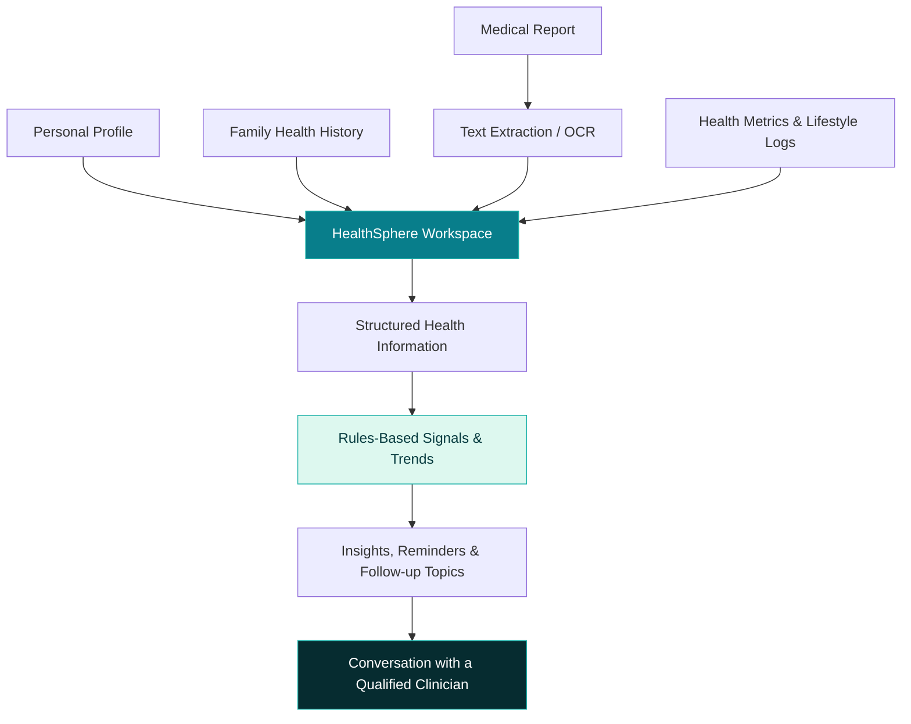

<!--
  HealthSphere | Project README
  Replace the dashboard placeholder with a real screenshot from the application.
-->

<div align="center">


### Your family's health story, connected.

**A family health intelligence and preventive-care workspace.**  
Keep health history, lab reports, wellness habits, and preventive insights together in one place.

<p>
  
  
  
  
</p>

<p>
  <a href="#-the-big-picture">The Big Picture</a> ·
  <a href="#-feature-explorer">Feature Explorer</a> ·
  <a href="#-how-it-works">How It Works</a> ·
  <a href="#-get-started">Get Started</a> ·
  <a href="#-roadmap">Roadmap</a>
</p>

</div>

---

<div align="center">

## 🫀 Health data is more powerful when it tells a connected story.

| 🌳 Family History | 🧪 Medical Reports | 💡 Preventive Insights | 🌱 Everyday Wellness |
|:---:|:---:|:---:|:---:|
| Explore patterns across generations | Turn report files into readable values | Understand signals and follow-up topics | Keep habits, goals, and reminders together |

</div>

## 🌍 The Big Picture

Health information often lives in different places: paper reports, phones, family conversations, and separate apps. That makes it harder to recognize patterns, keep records organized, and prepare for a clinician visit.

**HealthSphere** is a health-tech project designed to bring these pieces together. It combines family medical history, medical-report extraction, health trends, rules-based preventive-care signals, and lifestyle tracking in one workspace.

> **Our mission:** make personal and family health information easier to organize and understand — while keeping medical decisions in the hands of qualified healthcare professionals.

### The challenges we're tackling

- **Scattered records** — finding an old test report can be harder than it should be.
- **Missing family context** — family conditions are difficult to organize across generations.
- **Hard-to-read reports** — key values can take time to locate and compare.
- **Forgotten follow-ups** — everyday habits and next steps can slip through the cracks.

---

## ✨ Feature Explorer

<details open>
<summary><strong>🌳 Family Health History</strong> · Connect the generations</summary>
<br/>

- Build a family tree with relatives and relationships.
- Record known conditions and relevant history.
- Explore recurring patterns across family members.
- Use family context as one input for preventive-care discussions.

</details>

<details>
<summary><strong>🧪 Medical Report Upload & Extraction</strong> · From document to data</summary>
<br/>

- Upload supported PDF, TXT, JPG, and PNG reports.
- Extract text from supported documents; image uploads can use browser-based OCR.
- Review recognized analytes, values, flags, and reference ranges where available.
- Paste report text manually if automatic extraction does not work as expected.

</details>

<details>
<summary><strong>💡 Health Insights & Risk Signals</strong> · Make information easier to interpret</summary>
<br/>

- View rules-based preventive-care signals.
- Review contributing factors behind a signal.
- See suggested specialties or screening topics to discuss with a clinician.
- Treat insights as informational support, not as a diagnosis.

</details>

<details>
<summary><strong>📈 Health Trends & Lifestyle</strong> · Small habits, clearer patterns</summary>
<br/>

- Track supported health metrics and review trends over time.
- Log lifestyle habits such as sleep, exercise, and hydration.
- Use reminders to help keep follow-ups visible.

</details>

<details>
<summary><strong>🔐 Profile, Privacy & Data Controls</strong> · Stay in control of your records</summary>
<br/>

- Maintain personal health profile details.
- Review available consent and privacy controls.
- Export supported records in JSON format.
- Access the account-management options available in the current build.

</details>

<details>
<summary><strong>🩺 Care ecosystem</strong> · A foundation for connected care</summary>
<br/>

The repository also contains doctor, consultation, pharmacy/store, and hospital-discovery related modules. Exact workflows and integrations may vary by environment; verify availability in the current build before relying on a module.

</details>

---

## 🖼️ A Peek Inside

<div align="center">


<sub>Design note: replace this placeholder with a real application screenshot before sharing the project publicly.</sub>

</div>

**Screenshots worth showcasing**

| Screen | What it demonstrates |
|---|---|
| Dashboard | At-a-glance health workspace |
| Family tree | Relationships and recorded family history |
| Report analysis | Extracted report values and flags |
| Insights & trends | Rules-based signals, records, and progress |
| Care discovery | Doctor or care-related modules, if enabled |

To add screenshots, create a `screenshots/` folder, place your images in it, and replace the placeholder URL with a relative path such as `screenshots/dashboard.png`.

---

## 🧠 How It Works

<div align="center">



</div>

### 🏗️ Architecture at a glance

| Layer | Technology / approach | Purpose |
|---|---|---|
| Frontend | HTML, CSS, vanilla JavaScript SPA | Interactive health workspace |
| Application server | Node.js | API routes, authentication, application logic |
| Report processing | PDF/text parsing and Tesseract.js OCR | Extract and normalize report information |
| Data | Local JSON-backed storage in the default setup; PostgreSQL/Supabase options documented in production planning | Persist application records |
| Delivery foundation | Docker Compose, Nginx, GitHub Actions workflow files | Local containers and CI/CD foundations |

> **Implementation note:** The repository contains both application code and production-planning material. The actual database and deployment configuration depend on the environment; do not assume every planned integration is active by default.

---

## 🛠️ Built With

<div align="center">


<br/><br/>


</div>

- **Frontend:** HTML, CSS, vanilla JavaScript
- **Backend:** Node.js and application API modules
- **Report extraction:** PDF/text parsing and Tesseract.js OCR
- **Data options:** local application storage, with production migration planning for PostgreSQL/Supabase
- **Development & delivery:** Docker Compose, Nginx, GitHub Actions

---

## ⚡ Get Started

### Prerequisites

- [Node.js](https://nodejs.org/) **18 or later**
- [Git](https://git-scm.com/)
- A modern browser
- [Docker Desktop](https://www.docker.com/products/docker-desktop/) *(optional, for containerized startup)*

### Option A · Run with Node.js

```bash
# 1. Clone the repository
git clone https://github.com/Lakhan07AU/HealthSphere.git

# 2. Move into the backend application
cd HealthSphere/HealthSphere_AI/backend

# 3. Install dependencies
npm install

# 4. Start the server
npm start
```

Open **http://localhost:3000** in your browser.

For development mode:

```bash
npm run dev
```

Run the backend test suite:

```bash
npm test
```

### Option B · Run with Docker Compose

From the directory containing `docker-compose.yml`:

```bash
docker compose up --build
```

Open **http://localhost:8080**. To stop the containers:

```bash
docker compose down
```

> Commands are based on the repository's current scripts and Compose configuration. If your branch or local environment differs, follow the instructions in `HealthSphere_AI/README.md` and the terminal output.

### 🔑 Demo accounts & credentials

The implementation README documents seeded demonstration accounts for patient, admin, doctor, and store-owner roles. See `HealthSphere_AI/README.md` for the current local demo details and login routes.

**Security first:** never expose demo credentials on a public production deployment. Rotate or disable seeded accounts, use unique credentials, and configure secrets safely before onboarding real users.

---

## 🗂️ Repository Map

```text
HealthSphere/
└── HealthSphere_AI/
    ├── backend/
    │   ├── server.js              # Node.js application server
    │   ├── lib/                   # Auth, reports, insights, lifestyle & API modules
    │   ├── tests/                 # Backend tests
    │   └── package.json           # Scripts and dependencies
    ├── docker-compose.yml         # Container orchestration
    ├── README.md                 # Detailed implementation guide
    ├── README_PRODUCTION.md       # Production-readiness guide
    ├── PRODUCTION_PLAN.md         # Planned hardening and launch tasks
    └── .github/workflows/         # CI/CD workflow files
```

---

## 🧭 Roadmap

*These checkboxes communicate the project's current direction; they are not a promise that every deployment has every feature enabled.*

- [x] Family health history workspace
- [x] Medical report parsing and OCR workflow
- [x] Rules-based insights and preventive-care signals
- [x] Lifestyle tracking and reminders
- [x] Docker Compose local deployment foundation
- [ ] Validate end-to-end flows with realistic test data and user feedback
- [ ] Complete production database migration and backup/restore verification
- [ ] Strengthen security, privacy controls, auditability, and account recovery
- [ ] Improve accessibility and mobile experience
- [ ] Review medical content with qualified healthcare professionals
- [ ] Pilot with a small group before any wider public launch
- [ ] Explore FHIR-aligned interoperability and additional care integrations

<details>
<summary><strong>🔭 What we'd like to improve next</strong></summary>
<br/>

1. **Trustworthy extraction** — improve how report values, units, and reference ranges are parsed and presented.
2. **Clear explanations** — make health signals easy to understand, including their limitations.
3. **Privacy by design** — minimize data collection and test access, export, retention, and deletion flows.
4. **A better care journey** — help people prepare questions for clinician visits and remember next steps.
5. **Responsible growth** — learn from a small beta and improve reliability before expanding.

</details>

---

## 🛡️ Privacy & Responsible Use

Health information is sensitive. HealthSphere is being developed with privacy and responsible use in mind, but **this README is not a security certification or a claim of regulatory compliance**.

- Use dummy or synthetic health data during development and demonstrations.
- Never commit real medical reports, personal details, API keys, passwords, database URLs, or tokens.
- Review storage, access controls, backups, consent, retention, and deletion before real users are onboarded.
- Confirm the active configuration before describing data as local-only or end-to-end protected.
- HealthSphere is **not a substitute for professional medical advice, diagnosis, or treatment**. Seek qualified care for medical decisions and emergencies.

---

## 🤝 Contributing

Ideas, bug reports, and improvements are welcome.

1. Fork the repository.
2. Create a branch: `git checkout -b feature/your-feature`
3. Make a focused change and run the relevant tests.
4. Commit your work: `git commit -m "feat: describe your change"`
5. Push the branch and open a Pull Request.

Please do not include real personal health information in issues, screenshots, pull requests, or test fixtures.

---

## 💬 Connect & Collaborate

Have an idea, found a bug, or want to collaborate on responsible health technology?

- **Repository:** [Lakhan07AU/HealthSphere](https://github.com/Lakhan07AU/HealthSphere)
- **Issues & feedback:** [Open a GitHub issue](https://github.com/Lakhan07AU/HealthSphere/issues)
- **Developer:** [Lakhan Singh on GitHub](https://github.com/Lakhan07AU)

<div align="center">

---

### 🌱 Better organized health information. More informed conversations.

*Built as a health-tech project exploring family health history, report extraction, and preventive-care support.*

<a href="#healthsphere">⬆ Back to top</a>


</div>
